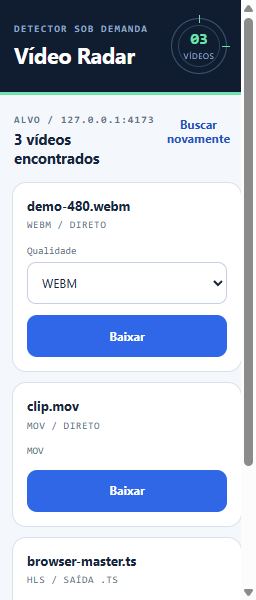

# Video Radar

[](https://github.com/carlosesl1/videodownloader/actions/workflows/ci.yml)
[](LICENSE)
[](#requirements)

Video Radar is an open-source, on-demand video detector and downloader for
Chromium-based browsers. It finds direct media (`.mp4`, `.webm`, `.mov`), HLS
playlists (`.m3u8`) and public YouTube formats, while requesting access only
when the user explicitly clicks **Buscar vídeos** ("Search videos").

> Use Video Radar only with media you own, public-domain/openly licensed media,
> or content you are explicitly authorized to download. The project does not
> bypass DRM, authentication, private content or access restrictions.

[Documentação completa em português](docs/README.pt-BR.md)



## Why Video Radar

- **On-demand access:** no continuous page or network monitoring.
- **Hybrid detection:** combines `<video>`/`<source>` elements with
  `PerformanceResourceTiming`.
- **Direct and HLS media:** downloads direct files and assembles compatible HLS
  MPEG-TS segments with up to eight concurrent requests.
- **Quality selection:** exposes HLS variants and public YouTube formats when
  available.
- **Durable progress:** closing and reopening the popup does not lose an active
  job's status.
- **Unified destinations:** use a default Windows folder or ask where each
  download should be saved.
- **Privacy by design:** no telemetry, analytics, accounts, cookies or browser
  profile access.
- **Chromium coverage:** Chrome, Edge, Brave and Vivaldi.

## Architecture

| Component | Responsibility |
| --- | --- |
| Manifest V3 extension | User interface, on-demand page scanning and browser downloads |
| Offscreen document | HLS fetching and MPEG-TS assembly |
| Windows native host | Folder picker, durable YouTube jobs and final file delivery |
| Pinned tools | `yt-dlp`, Deno and FFmpeg artifacts verified by SHA-256 during packaging |

The native host communicates through Chromium Native Messaging over `stdio`.
It does not start a localhost server, open a listening socket or send usage data
to the project maintainer.

## Requirements

- Windows 10 or Windows 11, x64
- Chrome, Edge, Brave or Vivaldi based on Chromium 116+
- PowerShell
- Internet access while packaging the native helper and while downloading
  authorized media

## Install from source

1. Clone the repository and enter its root directory.
2. Build the distributable native helper:

   ```powershell
   powershell -NoProfile -ExecutionPolicy Bypass -File scripts/package-native-helper.ps1
   ```

   The first build downloads the exact artifacts recorded in
   `native-host/tool-lock.json`. The generated package is stored in
   `dist\video-radar-helper` and is intentionally excluded from Git.
3. Open `chrome://extensions`, `edge://extensions`, `brave://extensions` or
   `vivaldi://extensions`, enable developer mode and load the **repository
   root** as an unpacked extension (**Carregar sem compactação**). Do not load
   `dist`.
4. Run `dist\video-radar-helper\Instalar-Video-Radar.cmd`.
5. Reload the extension. Its expected stable ID is
   `cakpfifpfmbdcilimpedanglnopnmckg`.

The root-level `Instalar-Video-Radar.cmd` is not the packaged installer. Run the
copy located inside `dist\video-radar-helper`.

## Use

1. Open a page containing authorized media.
2. Open Video Radar and click **Buscar vídeos** ("Search videos").
3. Choose an available quality and start the download.
4. Open **Configurar downloads** ("Configure downloads") to choose a default
   Windows folder or enable **Perguntar onde salvar cada download** ("Ask where
   to save each download").

Direct files use the browser download manager. Compatible HLS streams are
assembled as `.ts`. Public YouTube jobs use the native helper and preserve
their status while the popup is closed. Use **Cancelar** to stop an active job.
Automatic direct/HLS delivery temporarily uses
`Downloads\Video Radar\.staging`.

To uninstall completely, remove the extension from each browser and delete the
current-user Native Messaging registrations plus `%LOCALAPPDATA%\VideoRadar`.
The exact PowerShell commands are in the
[Portuguese documentation](docs/README.pt-BR.md#desinstalação).

## Development

The regular test suite is offline:

```powershell
npm run check
npm run check:all
```

`check:all` validates the extension, runs the JavaScript tests and runs the
native-host test executable. Packaging is separate because it may download
pinned third-party artifacts.

See [CONTRIBUTING.md](CONTRIBUTING.md), [SECURITY.md](SECURITY.md) and
[PRIVACY.md](PRIVACY.md) before contributing or reporting a problem.

## Known boundaries

- No DRM, private, authenticated, age-restricted or live-content bypass.
- No cookies, credentials, `netrc` or browser-profile access.
- No bulk playlist downloading; individual YouTube Shorts are supported.
- HLS support currently targets MPEG-TS output; incompatible fragmented MP4
  playlists are rejected safely.
- YouTube behavior depends on public formats supported by `yt-dlp` and may
  change when the service changes.

## License

Video Radar is available under the [MIT License](LICENSE). Bundled or downloaded
third-party tools retain their own licenses, which are included in generated
native-helper packages.
