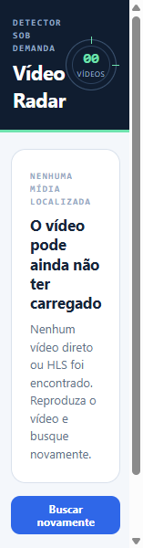

# Verificação — 21/07/2026

Verificação essencial realizada no Playwright Chromium 151 com a extensão carregada sem compactação e o service worker registrado.

## Resultados

- **Carregamento da extensão:** aprovado. O service worker foi registrado; o manifesto não contém `host_permissions` globais.
- **Varredura por clique explícito:** aprovada na fixture direta. Foram exibidos três grupos: variantes WEBM/MP4 do vídeo direto, MOV e HLS.
- **Qualidades:** as variantes diretas foram agrupadas e disponibilizadas para seleção.
- **Sem barra de progresso:** aprovado. O popup não mostra barra nem porcentagem de download.
- **Download direto:** aprovado. `chrome.downloads` chegou ao estado `complete` para `http://127.0.0.1:4173/media/demo-480.webm`. A interceptação do Playwright gravou o artefato com um GUID temporário, portanto o nome final no sistema de arquivos não foi validado nesse ensaio.
- **Estado vazio:** aprovado, com mensagem acionável para o usuário.
- **Contenção estreita:** aprovada nas capturas com popup de 256 px nos resultados e 157 px no estado vazio, sem corte horizontal. O zoom de 200% não foi repetido separadamente para evitar verificação excessiva.
- **HLS no navegador:** o clique confiável em **Ver qualidades** chegou ao estado individual **Preparando…**. Um prompt opcional de permissão do servidor bloqueou a automação e não foi aceito, de propósito, para respeitar a segurança da permissão. Portanto, o fluxo HLS completo não é declarado como aprovado em E2E de navegador.
- **Cobertura automatizada:** parser HLS, montagem, ordenação de qualidades e ciclo de vida estão cobertos pelos 117 testes automatizados já executados. Ainda é recomendada uma aceitação manual no Chrome para a permissão e o arquivo `.ts`.
- **Teclado:** não foi exercitado separadamente. A interface usa botões e seletores semânticos, foco visível e redução de movimento; recomenda-se uma passada manual por teclado.

## Evidências visuais

Resultados e download direto:

Estado vazio:

## Checklist manual recomendado

1. Abra uma página HLS com variantes 1080p, 720p e 480p.
2. Clique em **Buscar vídeos** e depois em **Ver qualidades**.
3. Confirme a ordem e escolha a qualidade desejada.
4. Autorize o servidor de mídia somente se reconhecer o domínio.
5. Inicie o download e feche o popup enquanto aparece **Preparando…**.
6. Confirme no gerenciador do Chrome que o download termina e gera um arquivo `.ts` reproduzível.
7. Confirme que nenhuma barra de progresso ou porcentagem é exibida no popup.
8. Faça uma navegação curta por `Tab`, `Shift+Tab`, `Enter` e `Espaço` para validar o uso por teclado.

